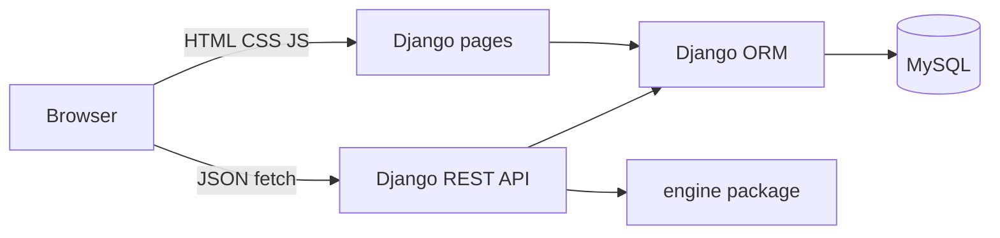
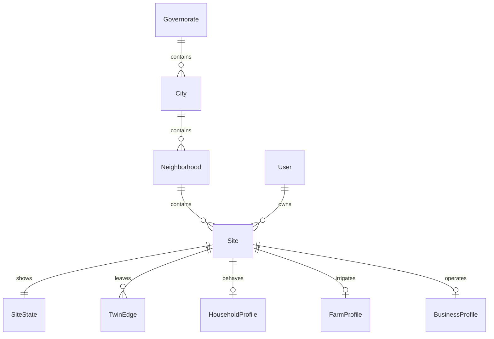
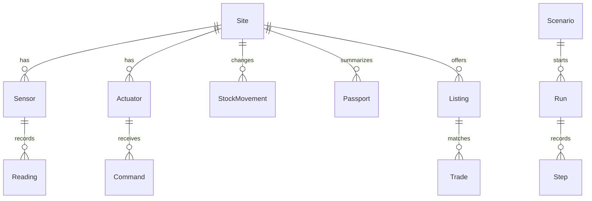

# KIZUNA architecture

KIZUNA is a living digital twin of a small resource network in Tunisia. Homes, a farm, a workshop, and a shared tank sit in one neighbourhood. The system shows how a water and heat crisis spreads, and what changes when households, reuse, and simple automatic actions respond.

Django is the whole backend. It serves pages, the database, the REST API, sign-in, and the simulation. The calculation code lives in the `engine` package and is called by Django inside the same process. The browser uses HTML, Bootstrap, and vanilla JavaScript. Three.js draws the neighbourhood. Leaflet draws the map. Chart.js draws the time series.

MySQL is the project database.

This document is the build spec for a 48-hour hackathon. The repository currently contains the Django skeleton, the custom user, a home page, and a health check. The tables and the simulation described below are the next work. The Python functions in `engine` raise `NotImplementedError` until the phase named in each file.

## How the running system fits together



A tick is one simulated hour. The browser asks Django to advance one tick. Django loads the run, calls `engine`, stores the result, and returns one JSON state. The same JSON feeds the chart, the map colour, and the 3D scene.

There is one web process. There is no second API, no task queue, and no message bus.

## What is already in the repository

- Django 5.2 project package: `config`
- Thirteen apps under `apps`, registered in settings
- Custom user with a role, in `apps.accounts`
- MySQL connection through PyMySQL
- `GET /` home page
- `GET /api/v1/health/`
- `static/js/api.js`, the JSON client the later pages will use
- `engine` modules with the class names the tick will call

`KIZUNA_USE_SQLITE=1` exists so a laptop can boot before MySQL is installed. The demo database is MySQL. Rehearse the crisis day against MySQL before the jury.

## Folder structure

```
kizuna/
├── manage.py
├── requirements.txt
├── .env.example
├── .gitignore
├── ARCHITECTURE.md
├── config/
│   ├── __init__.py          # registers PyMySQL as MySQLdb
│   ├── settings.py
│   ├── urls.py              # /admin, /api/v1, and pages
│   ├── api_urls.py          # mounts one prefix per app
│   ├── asgi.py
│   └── wsgi.py
├── apps/
│   ├── accounts/
│   ├── homes/
│   ├── farms/
│   ├── businesses/
│   ├── resources/
│   ├── sensors/
│   ├── actuators/
│   ├── simulation/
│   ├── ai_engine/
│   ├── crisis/
│   ├── digital_twin/
│   ├── marketplace/
│   └── dashboard/
├── engine/
│   ├── orchestrator.py      # calls the agents in order
│   ├── prediction.py
│   ├── anomaly.py
│   ├── crisis_engine.py
│   ├── autopilot.py
│   ├── exchange.py
│   └── simulation_loop.py
├── templates/
│   ├── base.html
│   └── dashboard/
├── static/
│   ├── css/kizuna.css
│   └── js/
│       ├── api.js
│       ├── simulation.js
│       ├── charts.js
│       ├── map.js
│       └── twin.js
└── media/models/            # optional sklearn files, phase 7
```

Each app keeps Django’s usual files: `models.py`, `views.py`, `admin.py`, `apps.py`, `tests.py`, `urls.py`, and `migrations/`. API apps also gain `serializers.py` in the phase that first returns JSON for that app.

`dashboard` owns every HTML page. The other apps own data and JSON. That keeps the templates in one place.

## Django apps

| App | Responsibility |
| --- | --- |
| `accounts` | Sign-in and the user role: citizen, farmer, business, operator, admin. |
| `digital_twin` | Governorate, city, neighbourhood, site, live stocks, and the pipes or cables between sites. |
| `homes` | Household profile: people, conservation, flexibility, daily water and energy. |
| `farms` | Crop, area, irrigation need, pump load. |
| `businesses` | Opening hours, critical load, water use, greywater share. |
| `resources` | Resource types, stock movements, and the resource passport. |
| `sensors` | Meters and the readings the charts plot. |
| `actuators` | Valves, pumps, and the commands the autopilot would send. |
| `simulation` | Scenarios, runs, and one saved JSON state per tick. |
| `ai_engine` | Stored forecasts, anomalies, and the orchestrator’s decision log. |
| `crisis` | Crisis events, propagation log, resilience scores, league query. |
| `marketplace` | Surplus listings and credit trades inside the neighbourhood. |
| `dashboard` | HTML pages only. No tables. |

The sixteen ideas map onto those apps like this.

| Idea | Where it lives |
| --- | --- |
| Living digital twin | `Site`, `SiteState`, `TwinEdge`, the twin JSON, Three.js |
| What-if crisis simulation | `Scenario`, `Run`, `Step` |
| Crisis propagation | Volume moved along `TwinEdge`, unmet demand stored on the step |
| Personalized household profiles | `HouseholdProfile` |
| KIZUNA Autopilot | `AutopilotAgent` and `Command` |
| Resource passport | `Passport`, summed from `StockMovement` |
| Resilience League | Page that sorts `ResilienceScore` |
| Water second life | Resource `reused_water` and the workshop-to-farm edge |
| Energy second life | Resource `stored_energy` and share movements |
| KIZUNA Exchange | `Listing`, `Trade`, `ExchangeAgent` |
| Weather-triggered actions | Temperature on the scenario, rules in `AutopilotAgent` |
| KIZUNA Brain | Forecast, anomaly, and decision rows, shown on the crisis page |
| Specialist agents and orchestrator | Classes in `engine`, one process |
| Tunisia Resilience Score | `ResilienceScore` row with level `country` |
| Home, neighbourhood, city, Tunisia | `Site` rolls up to `Neighborhood`, `City`, `Governorate`, then one country row |
| Crisis Day demonstration | Scenario `crisis-day` and the page `/crisis-day/` |

## Shared site

Homes, farms, businesses, and the tank are all a `Site`. Profiles, sensors, stocks, and commands point at `Site`. A home-only table does not grow its own copy of latitude, owner, and capacity.

`digital_twin` does not import the profile apps. The profile models point at `Site`. Use these related names: `household_profile`, `farm_profile`, `business_profile`, `state`.

A site’s `kind` is `home`, `farm`, `business`, or `infrastructure`. The seed creates the one profile that matches the kind. Infrastructure has stocks and edges and no profile.

## Two copies of state

`SiteState` is the live twin. A simulation run does not write it.

`Step.state` is the what-if copy. Crisis Day draws `Step`. The live stocks stay at the seed baseline, so the jury can restart. `Run.apply_to_live` defaults to false and stays false for the demo.

## Database

Create every table in phase 1. Seed only the demo neighbourhood. Later phases fill the other tables.

Use `DecimalField(max_digits=12, decimal_places=3)` for cubic metres, kilowatt-hours, and credits. Use floats for coordinates, scene position, and stress. Use integers from 0 to 100 for published scores. Use `JSONField` for scenario parameters and for the twin snapshot on each step. Times are timezone-aware. The project timezone is `Africa/Tunis`.

Delete a parent place and its demo children with it (`CASCADE`) so `seed_demo` can rebuild the neighbourhood. Set `Site.owner` to null if that user is removed.

### Places and the twin

`digital_twin.Governorate`

- `name`, `code` unique

`digital_twin.City`

- `governorate` foreign key
- `name`, `latitude`, `longitude`

`digital_twin.Neighborhood`

- `city` foreign key
- `name`, `latitude`, `longitude`

`digital_twin.Site`

- `neighborhood` foreign key
- `owner` foreign key to the user, null allowed
- `kind` (`home`, `farm`, `business`, `infrastructure`)
- `name`
- `latitude`, `longitude` for Leaflet
- `scene_x`, `scene_y`, `scene_z` for Three.js

Map position and scene position are separate. The hackathon does not project latitude into the 3D scene.

`digital_twin.SiteState`

- `site` one-to-one
- `water_stock_m3`, `water_capacity_m3`
- `energy_stock_kwh`, `energy_capacity_kwh`
- `mode` (`normal`, `conserve`, `autopilot`, `crisis`)
- `updated_at`

`digital_twin.TwinEdge`

- `from_site`, `to_site`
- `resource_code` (`potable_water`, `reused_water`, `grid_energy`, `stored_energy`)
- `capacity` per tick
- `loss_factor` from 0 to 1
- unique together: origin, destination, resource

### Profiles

`homes.HouseholdProfile` — one-to-one with `Site`

- `occupants`
- `conservation_score` 0–100
- `flexibility` 0–100
- `liters_per_person_per_day`
- `daily_energy_kwh`
- `morning_peak`, `evening_peak`

`farms.FarmProfile` — one-to-one with `Site`

- `crop_name`
- `area_m2`
- `irrigation_mm_per_day`
- `pump_kw`

`businesses.BusinessProfile` — one-to-one with `Site`

- `sector`
- `opens_hour`, `closes_hour`
- `critical_load_kw`, `flexible_load_kw`
- `daily_water_m3`
- `greywater_share` 0–1

### Resources, meters, commands

`resources.ResourceType`

- `code` unique, `name`, `unit`

Seed codes: `potable_water` (m3), `reused_water` (m3), `grid_energy` (kWh), `stored_energy` (kWh).

`resources.StockMovement`

- `site`, `resource`
- `amount` positive
- `direction` `in` or `out`
- `reason` (`consumption`, `supply`, `reuse`, `share`, `storage`, `trade`, `loss`)
- `run` null, `tick` null
- `created_at`
- index `(site, created_at)`

`resources.Passport`

- `site`, `period_start`, `period_end`
- `water_used_m3`, `water_reused_m3`
- `energy_used_kwh`, `energy_shared_kwh`
- `circularity_score`

Circularity is reused water plus shared energy, over use plus those recovered amounts, as a score from 0 to 100. The passport is a summary row. The movements are the detail.

`sensors.Sensor`

- `site`, `kind` (`water_meter`, `energy_meter`, `soil_moisture`, `tank_level`, `temperature`)
- `unit`, `is_active`

`sensors.Reading`

- `sensor`, `value`, `recorded_at`
- index `(sensor, recorded_at)`

Each tick writes a water reading and an energy reading from that hour’s demand. The demo does not need a physical meter.

`actuators.Actuator`

- `site`, `kind` (`valve`, `pump`, `irrigation`, `relay`), `is_active`

`actuators.Command`

- `actuator`
- `action` (`open`, `close`, `on`, `off`, `set`), `value` null
- `source` (`manual`, `autopilot`, `weather`, `simulation`)
- `status` (`pending`, `applied`, `failed`)
- `run` null, `created_at`

A command is a record of what the twin decided. The hackathon does not open a serial port or call a device API. `applied` means the run accepted the command.

### Simulation, brain, crisis, exchange

`simulation.Scenario`

- `slug` unique, `name`, `description`
- `parameters` JSON

`simulation.Run`

- `scenario`, `neighborhood`
- `status` (`ready`, `running`, `finished`)
- `current_tick`
- `apply_to_live` default false
- `started_at`, `finished_at` null

`simulation.Step`

- `run`, `tick`
- `state` JSON, the twin snapshot below
- `decisions` JSON
- unique `(run, tick)`

`ai_engine.Forecast`

- `site`, `resource_code`, `horizon_hours`, `predicted_value`, `model_name`, `created_at`

`model_name` is `formula` until phase 7, then `linear_regression` when a model file exists.

`ai_engine.Anomaly`

- `site`, `sensor` null, `score`, `message`, `created_at`

`ai_engine.AgentDecision`

- `run` null, `tick` null, `agent_name`, `payload` JSON, `created_at`

`crisis.CrisisEvent`

- `title`
- `crisis_type` (`drought`, `heatwave`, `outage`, `flood`, `demand_spike`)
- `severity` 1–5
- `neighborhood` null
- `description`, `is_active`, `started_at`

`crisis.PropagationLink`

- `event`, `from_site`, `to_site`, `tick`
- `unmet_amount`

The engine appends a row when a site still has unmet demand after pulls along its edges. The page reads this as the wave. Volume on `TwinEdge` is what actually moves. The link is the log.

`crisis.ResilienceScore`

- `level` (`site`, `neighborhood`, `city`, `country`)
- `site` null, `neighborhood` null, `city` null
- `score`, `water_security`, `energy_security`, `circularity`, `readiness`
- `computed_at`
- a site, neighbourhood, or city row has that one foreign key set
- the country row has level `country` and the three foreign keys empty

`marketplace.Listing`

- `site`, `resource`, `quantity`, `credits`
- `status` (`open`, `matched`, `cancelled`), `created_at`

`marketplace.Trade`

- `listing`, `buyer_site`, `quantity`, `credits`
- `status` (`proposed`, `accepted`, `rejected`)

Credits are integers inside the demo. There is no payment provider.

### Relationships





### Demo seed

One fictional neighbourhood, placed on the map near central Tunis so Leaflet has a real region to show. The place is synthetic. It is not an official district and it is not a measured water network.

- Governorate Tunis, city Tunis
- Neighbourhood `Cité KIZUNA`, latitude `36.8065`, longitude `10.1815`
- Sites: `Cité Tank`, `Home 1` through `Home 5`, `Olivette Farm`, `Atelier`
- Give the five homes different `conservation_score` and `flexibility` values so the profiles are visibly personal
- Edges: tank to each home (`potable_water`), tank to farm (`potable_water`), Atelier to farm (`reused_water`)

Starting stocks, to tune in rehearsal so twelve ticks are visible on a chart:

| Site | Water capacity m3 | Water stock | Energy capacity kWh | Energy stock |
| --- | ---: | ---: | ---: | ---: |
| Cité Tank | 30 | 24 | 0 | 0 |
| Each home | 2 | 1.5 | 10 | 8 |
| Olivette Farm | 8 | 4 | 15 | 10 |
| Atelier | 3 | 2 | 40 | 30 |

Starting profile numbers:

- Home: 4 occupants, 150 litres per person per day, 12 kWh per day, morning peak 1.8, evening peak 1.6
- Farm: olives, 2000 m2, 6 mm irrigation per day, pump 1.5 kW
- Atelier: open 08:00–17:00, critical load 4 kW, flexible load 3 kW, 2 m3 water per day, greywater share 0.6

Edge capacities per tick: 0.4 m3 to each home, 2 m3 to the farm, 0.3 m3 reused water from the workshop. `loss_factor` 0.05.

Command `python manage.py seed_demo` lives in `apps/digital_twin/management/commands/seed_demo.py`. It deletes this neighbourhood and writes it again.

### Resilience score

For a site, after a tick:

- `water_security = round(100 * (1 - water_stress))`
- `energy_security = round(100 * (1 - energy_stress))`
- If water capacity is 0, water stress is 0. Same rule for energy. A tank with no battery is not an energy failure.
- `circularity` comes from the passport formula. Use 0 when the run has not moved any recovered water or energy yet.
- `readiness` is 100 when the site has a profile and an active actuator, 50 when it has a profile only, 100 for the tank, 0 otherwise.
- `score = round(0.35 * water_security + 0.35 * energy_security + 0.15 * circularity + 0.15 * readiness)`

The neighbourhood score is the rounded mean of its site scores. The city score is the mean of its neighbourhoods. The country score is the mean of its cities. With one neighbourhood, those three numbers match. Label the country number `demo rollup from Cité KIZUNA`. It is a rollup of the demo, not a national statistic.

The league ranks sites in the selected neighbourhood by score. When a second neighbourhood exists, the same page can rank neighbourhoods.

## API

The prefix is `/api/v1/`. Django REST framework uses session cookies. `static/js/api.js` sends JSON and, on any request with a body, the `X-CSRFToken` header. Reads are open. Any POST requires a signed-in user. The health view is plain Django and is open.

Build `serializers.py` in the app that owns the endpoint. Return the usual REST framework error body, `{"detail": "..."}`.

| Method and path | Purpose | Phase |
| --- | --- | --- |
| `GET /api/v1/health/` | Liveness. Already implemented. | 0 |
| `POST /api/v1/accounts/login/` | Session login. | 2 |
| `POST /api/v1/accounts/logout/` | End the session. | 2 |
| `GET /api/v1/accounts/me/` | Current user and role. | 2 |
| `GET /api/v1/twin/neighborhoods/` | Places for the map. | 2 |
| `GET /api/v1/twin/sites/?neighborhood=` | Sites and profiles. | 2 |
| `GET /api/v1/twin/sites/{id}/` | One site. | 2 |
| `GET /api/v1/twin/graph/?neighborhood=` | Live twin JSON from `SiteState`. | 2 |
| `GET /api/v1/twin/scores/?level=&id=` | Stored scores. | 3 |
| `GET /api/v1/homes/{site_id}/` and `PATCH` | Household profile. | 2 |
| `GET /api/v1/farms/{site_id}/` and `PATCH` | Farm profile. | 2 |
| `GET /api/v1/businesses/{site_id}/` and `PATCH` | Business profile. | 2 |
| `GET /api/v1/resources/passports/?site=` | Passport rows. | 6 |
| `GET /api/v1/sensors/?site=` | Meters. | 3 |
| `GET /api/v1/sensors/{id}/readings/?limit=48` | Series for Chart.js. | 3 |
| `GET /api/v1/actuators/?site=` | Devices. | 6 |
| `POST /api/v1/actuators/{id}/commands/` | Manual command. | 6 |
| `GET /api/v1/simulation/scenarios/` | What-if list. | 3 |
| `POST /api/v1/simulation/runs/` | Body `{scenario, neighborhood}`. Copies baseline into step 0. | 3 |
| `GET /api/v1/simulation/runs/{id}/` | Status and current tick. | 3 |
| `POST /api/v1/simulation/runs/{id}/tick/` | Body `{steps: 1}`. Returns the new twin JSON. | 3 |
| `GET /api/v1/simulation/runs/{id}/state/` | Latest twin JSON, for reload. | 3 |
| `GET /api/v1/crisis/events/` | Crisis headers. | 3 |
| `GET /api/v1/crisis/league/?level=site&neighborhood=` | Ranking. | 6 |
| `GET /api/v1/ai/forecasts/?site=` | Brain panel. | 3 |
| `GET /api/v1/ai/anomalies/` | Brain panel. | 7 |
| `GET /api/v1/exchange/listings/` | Open offers. | 6 |
| `POST /api/v1/exchange/listings/` | Create an offer. | 6 |
| `POST /api/v1/exchange/match/` | Greedy match inside the neighbourhood. | 6 |

Pages, all rendered by `dashboard`:

| Page | When |
| --- | --- |
| `GET /` | Already implemented. |
| `GET /crisis-day/` | Phase 3. This is the jury page. |
| `GET /map/` | Phase 4. |
| `GET /twin/` | Phase 5. |
| `GET /league/` | Phase 6. |
| `GET /exchange/` | Phase 6. |

Admin at `/admin/` is enough for editing seed data during the hackathon.

## Simulation

`engine.simulation_loop.tick(run_id, steps=1)` is the only entry. The view loads nothing about hydraulics itself. It calls `tick` and returns the state.

`tick` calls `Orchestrator.decide`. Phase 3 implements that method. `AnomalyAgent`, `AutopilotAgent`, and `ExchangeAgent` return empty lists until their own phase.

### Scenario `crisis-day`

```json
{
  "ticks": 12,
  "temperature_c": 38,
  "heat_threshold_c": 35,
  "supply_factor": 0.4,
  "tank_inflow_m3": 1.5
}
```

`supply_factor` multiplies water entering the tank. Heat raises irrigation and household demand. Twelve ticks are twelve hours, long enough to narrate and short enough to replay.

### Demand formulas

`heat_factor = 1 + max(0, temperature_c - 30) * 0.05`. At 38°C the factor is 1.4.

Household water, then the same weights for household energy:

```
daily_m3 = occupants * liters_per_person_per_day / 1000
hour = tick % 24
weight = morning_peak   if 6 <= hour < 9
       = evening_peak   if 18 <= hour < 22
       = 0.7            otherwise
demand = daily_m3 * weight / sum(weight over 24 hours) * heat_factor
demand = demand * (1 - conservation_score / 200)
```

Conservation can remove up to half of demand. Flexibility is the share that can move when the mode is `conserve`:

```
demand = demand * (1 - flexibility / 100)
```

Farm irrigation is planned at hours 5, 6, and 7. A weather action moves it to 21, 22, and 23.

```
daily_m3 = area_m2 * irrigation_mm_per_day / 1000
if hour in irrigation_hours:
    water = daily_m3 / 3 * heat_factor
    energy = pump_kw
else:
    water = 0
    energy = 0
```

The farm prefers `reused_water` and uses `potable_water` for what greywater did not cover.

Workshop:

```
energy = critical_load_kw + flexible_load_kw    if open
       = critical_load_kw                       if closed
water = daily_water_m3 / 24
reused inflow = water * greywater_share
```

Greywater is produced into the workshop’s `reused_water` stock at the start of the tick. The farm can pull it along the edge in that same tick.

### One tick

1. Add tank inflow: `tank_inflow_m3 * supply_factor`.
2. Add greywater at the workshop.
3. Compute every site’s demand with the formulas.
4. Subtract demand from that site’s own matching stock. Irrigation takes reused water first.
5. If a stock would go below zero, set it to zero and keep the remainder as unmet demand.
6. Serve unmet demand from incoming edges, one hop only.
   - Default order: largest water demand first, so the farm reaches the tank first.
   - Moved volume is the minimum of unmet demand, edge capacity, and the neighbour’s surplus.
   - Volume that arrives is `moved * (1 - loss_factor)`.
7. If unmet demand remains, append a `PropagationLink` and set stress to at least 0.85.
8. Otherwise `stress = 1 - stock / capacity`, clamped from 0 to 1. Capacity 0 means stress 0.
9. Write readings, the step JSON, and scores.
10. Stop at `parameters.ticks` and mark the run finished.

Phase 6 changes step 6 during a drought (`supply_factor < 1`): serve homes, then the workshop, then the farm, and keep the farm on reused water first. It also shifts irrigation and sets homes to `conserve` when `temperature_c >= heat_threshold_c`. Record those as commands with source `weather` or `autopilot`.

Phase 3 can ship with the default order and the heat factor only. The jury already sees the tank fall and the homes follow. Phase 6 is the response.

### Crisis Day story

Tell it in this order. The page should be able to replay it from tick 0.

1. Morning, stocks healthy, mode `normal`.
2. Temperature is 38°C, so farm demand rises.
3. Tank inflow drops to 40%.
4. The farm draws the shared tank down. Homes feel the next hours.
5. The chart and the 3D colours move together, because both read the same step JSON.
6. Phase 6, if it is ready: irrigation moves to the evening, homes conserve, a greywater flow reaches the farm, and the league order changes.
7. Reset starts a new run from the seed baseline.

Greywater in this seed is a partial second life. It does not replace the missing tank water. Say that on the page. The interesting result is that the farm’s remaining potable pull gets smaller.

## AI architecture

The orchestrator is a class, not a service:

```mermaid
sequenceDiagram
  participant View
  participant Loop
  participant Brain
  participant MySQL
  View->>Loop: tick(run_id)
  Loop->>Brain: decide(state)
  Brain->>Brain: forecast
  Brain->>Brain: anomaly
  Brain->>Brain: allocate crisis
  Brain->>Brain: autopilot
  Brain->>Brain: exchange
  Brain-->>Loop: decision bundle
  Loop->>MySQL: Step, readings, scores, decisions
  Loop-->>View: twin JSON
```

The bundle:

```json
{
  "forecast": [],
  "anomalies": [],
  "crisis": {"unmet": []},
  "actions": [],
  "trades": []
}
```

`ForecastAgent` uses the formulas and stores `model_name = "formula"`. That path always works offline.

Phase 7, and only after Crisis Day has been replayed successfully:

- Command `python manage.py train_demo`
- Train one `LinearRegression` on the demo’s own water readings: predict the next reading from the previous three
- Save `media/models/water_demand.joblib`
- If that file exists, `ForecastAgent` uses it and stores `model_name = "linear_regression"`
- If it does not exist, or the library is not installed, keep the formula
- `AnomalyAgent` flags a reading whose z-score against the previous twelve readings is above 3
- Isolation Forest is optional after the z-score path works

The model file stays on disk. MySQL stores the prediction and the model name.

Show the latest forecast, anomaly, and `AgentDecision` rows in a panel on `/crisis-day/`. That panel is KIZUNA Brain.

## Digital twin state

`POST .../tick/` and `GET .../state/` return this object. `GET /api/v1/twin/graph/` returns the same shape with `"tick": 0` and no `run_id`, built from `SiteState`.

```json
{
  "tick": 4,
  "run_id": 1,
  "scenario": "crisis-day",
  "neighborhood": {"id": 1, "name": "Cité KIZUNA"},
  "nodes": [
    {
      "id": 1,
      "kind": "home",
      "name": "Home 1",
      "lat": 36.807,
      "lng": 10.182,
      "scene": {"x": -2, "y": 0, "z": 1},
      "water": {"stock_m3": 1.2, "capacity_m3": 2.0, "stress": 0.4},
      "energy": {"stock_kwh": 8.0, "capacity_kwh": 10.0, "stress": 0.2},
      "mode": "conserve",
      "alerts": ["unmet water 0.05 m3"]
    }
  ],
  "edges": [
    {
      "id": 3,
      "from": 8,
      "to": 7,
      "resource": "reused_water",
      "flow": 0.12,
      "capacity": 0.3
    }
  ],
  "scores": {
    "neighborhood": 62,
    "water_security": 48,
    "energy_security": 80,
    "circularity": 20,
    "readiness": 90,
    "label": "demo rollup from Cité KIZUNA"
  }
}
```

`flow` is the volume moved on that edge during the tick. Scene `y` stays 0. The ground plane is x–z.

## Browser and Django

Pages are same-origin. JavaScript calls relative paths such as `/api/v1/simulation/runs/1/tick/`. Cookies identify the session. `api.js` is the only fetch wrapper. Pages pass the neighbourhood id and the run id in `data-` attributes on the root element. They do not scrape numbers out of HTML.

Crisis Day autoplay is a loop in `simulation.js`:

1. `POST` the tick endpoint with `{steps: 1}`.
2. Draw the returned state with Chart.js and, once those phases exist, Leaflet and Three.js.
3. Wait one second.
4. Stop on the last tick or when the person presses stop.

Reload uses `GET .../state/`. There is no websocket. Eight sites make a tick fast enough to finish inside the request.

## Three.js

`static/js/twin.js` exports `renderTwin(container, twinState)`. Phase 5 implements it. The scene is a neighbourhood of simple meshes, not a building model.

- Perspective camera, fixed, looking at the origin
- Ambient light plus one directional light
- A ground plane
- `home`: box about `1 × 0.8 × 1`
- `farm`: low box about `1.6 × 0.25 × 1.6`
- `business`: taller box about `1 × 1.6 × 1`
- `infrastructure`: cylinder for the tank
- Mesh position from `scene.x` and `scene.z`
- Colour from `max(water.stress, energy.stress)`: calm blue `#2f6fed`, strain amber `#e0a100`, crisis red `#c0392b`
- An edge is a line. Its opacity is `flow / capacity`
- A click uses a raycaster and fills an HTML side panel with the site name, both stocks, the mode, and alerts
- Labels stay in HTML

Load Three.js from a CDN module URL on the twin page. A fixed camera is the plan. Orbit controls are optional if the fixed view already reads clearly.

The twin page and the crisis page must use the same state object. Do not invent a second 3D format.

## Leaflet and Chart.js

`map.js` exports `renderMap(container, places)`.

- Container height about 480px
- Center `[36.8065, 10.1815]`, zoom 13, for Cité KIZUNA
- OpenStreetMap tiles
- One circle marker per site, coloured from that site’s score with the same blue–amber–red idea
- Popup: name, kind, score

A control that zooms the camera out to Tunisia (about `[34, 9]`, zoom 6) can wait until the neighbourhood view works.

`charts.js` exports `renderCharts(targets, series)`.

- Line chart: water stock and energy stock against tick, from `Step` or from readings
- Bar chart: the four score components
- Bar chart on the league page: sites sorted by score

Two charts on Crisis Day are enough. Add the league chart with the league page.

## Development order

The cut line is the end of phase 5. Rehearse Crisis Day before starting phase 6. Phase 7 waits until that rehearsal has succeeded once.

| Phase | Work | Done when |
| --- | --- | --- |
| 0 | Skeleton. This repository. | `/` loads and `/api/v1/health/` returns ok. |
| 1 | Every model in this document. Admin registration. `seed_demo`. | Admin shows Cité KIZUNA and eight sites. |
| 2 | Read APIs for places, sites, and profiles. Session login. A numbers page. | The page shows seed stocks and names from MySQL. |
| 3 | Formulas, allocation, step JSON, readings, scores, Crisis Day page, two charts. | Twelve ticks change the stocks, and reset starts clean. |
| 4 | Leaflet markers from the same sites. | A marker click shows the site score. |
| 5 | Three.js meshes from the tick JSON. | Colours change as the crisis page advances. |
| 6 | Conserve mode, irrigation shift, greywater preference, passport, exchange credits, league. | A second replay shows the farm taking reused water and the ranking moving. |
| 7 | `train_demo`, linear regression, z-score anomalies, brain panel. | With the model file removed, the formula forecast still runs. |

Suggested pace for 48 hours: phase 1 on the first morning, phase 2 that afternoon, phase 3 overnight into the second morning, phases 4 and 5 on the second day, rehearsal before any further feature. If the clock is short, stop after phase 5. The story is already complete: the crisis spreads across the neighbourhood and the twin, the map, and the chart agree.

Build the seed and the tick before the 3D scene. The scene is a view of the JSON. It cannot lead the data model.

## Leave these out

These are the choices most likely to consume the hackathon without helping the jury.

- A second backend, a worker queue, Redis, or Django Channels. The tick is a normal request.
- JWT, social login, and more than one login screen. Use the session endpoint plus admin.
- Payments, invoices, or a real currency. Exchange credits are integers.
- Serial ports, MQTT, or live IoT. Actuators are rows in MySQL.
- A weather vendor as a required dependency. Temperature is a field on the scenario. A fetched forecast can fill that same field later.
- PostGIS. Latitude and longitude on the site are enough for Leaflet.
- Generic foreign keys. Scores point at a site, a neighbourhood, a city, or the country row.
- One database row per site per tick. One `Step` JSON per hour is the history.
- Photoreal buildings, interior rooms, and a custom shader. Coloured boxes tell the story.
- Training models before the formula tick works. The formula is the baseline.
- A country map of all 24 governorates. One city and one neighbourhood are the demo. The rollup function is what makes the score “Tunisia”.
- French and Arabic translations, mobile apps, and Docker as a requirement. Run MySQL and `runserver` locally.
- Extra Django apps. Thirteen is already the full map of the idea. `dashboard` has no models on purpose. The league is a query, not an app.

`requirements.txt` includes Django, Django REST framework, PyMySQL, pandas, NumPy, and scikit-learn. Import pandas, NumPy, and scikit-learn only in phase 7. Crisis Day must run if those imports are absent.

PyMySQL is the MySQL driver because it installs on Windows without a C compiler. `config/__init__.py` registers it as `MySQLdb`, which is the name Django expects.

This machine’s interpreter is Python 3.14. Django 5.2.19 declares support for 3.10 through 3.14. If a scientific wheel fails to install, use the formula forecast and continue.

## Run

From the project root, with MySQL 8 running:

```sql
CREATE DATABASE kizuna CHARACTER SET utf8mb4 COLLATE utf8mb4_unicode_ci;
CREATE USER 'kizuna'@'localhost' IDENTIFIED BY 'choose-a-password';
GRANT ALL PRIVILEGES ON kizuna.* TO 'kizuna'@'localhost';
```

```powershell
python -m venv .venv
.\.venv\Scripts\Activate.ps1
pip install -r requirements.txt
Copy-Item .env.example .env
```

Set `MYSQL_PASSWORD` in `.env` to the password above. Django loads that file on startup. A variable already set in the shell wins over the file.

```powershell
python manage.py migrate
python manage.py createsuperuser
python manage.py runserver
```

Open `http://127.0.0.1:8000/` and `http://127.0.0.1:8000/api/v1/health/`.

Before MySQL is installed, a one-off check can use SQLite:

```powershell
$env:KIZUNA_USE_SQLITE = '1'
python manage.py migrate
python manage.py runserver
```

Switch back to MySQL for phase 1 and stay there. JSON fields and decimals should be rehearsed on the database the jury will see.
